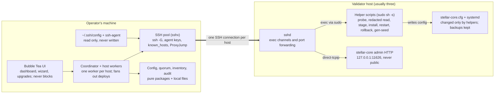
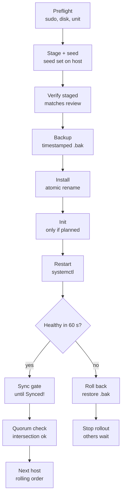

# Auriga — Specification

Last updated 3 November 2026. Stellar facts checked against the SDF docs on 2 November 2026.

## Overview

Auriga (binary `auriga`) is an open-source terminal UI that lets a Stellar validator operator configure, deploy and watch stellar-core on their own hosts over SSH, usually an organisation's three validators, from one screen.

**Who it is for:** operators running one to three (or more) stellar-core nodes on testnet or pubnet, including organisations on the Tier 1 path, which run three geographically dispersed Full Validators.

**V1 goals**

- Connect to hosts already defined in `~/.ssh/config`, using the operator's existing SSH keys or agent, with several connections held open at once.
- Configure a node end to end: network, keys, validator type, quorum set and history archive.
- Adopt nodes that are already running without breaking them.
- Show each node's `info` endpoint live, fetched over SSH.
- Inspect, arm and clear network upgrade votes across hosts through the admin HTTP endpoint, reached over SSH.

**Non-goals for v1:** installing stellar-core or provisioning servers, replacing Prometheus/Grafana monitoring, running Horizon or RPC, and building Soroban settings proposals.

**Design principles** (each is a hard requirement, tested in CI where possible)

1. A secret seed never leaves its validator host unless the operator pastes one in, and it never touches the operator's disk.
2. Nothing changes on a host without a preview (a config diff or the exact command) and a confirmation; pubnet changes need a typed confirmation.
3. The admin HTTP port is never exposed; the tool reaches it only through the SSH connection.
4. Every change is written to a local audit log (without secrets) and can be rolled back where the platform allows.
5. The UI never blocks: all remote work runs in the background and reports back.

**Using this spec with Claude Code:** this file is `SPEC.md`; `CLAUDE.md` points to it. Build in the milestone order in the build-order section; each milestone ends with its own tests passing.

## V1 scope

V1 covers six capabilities; anything that installs software, provisions infrastructure or submits transactions waits for a later version.

| Area            | In v1                                                                                                                   | Not in v1                                                                      |
| --------------- | ----------------------------------------------------------------------------------------------------------------------- | ------------------------------------------------------------------------------ |
| Hosts           | Pick hosts from `~/.ssh/config`, connect with keys or agent, hold several connections open, reconnect automatically     | Password logins, `ProxyCommand`, creating hosts or users                       |
| Network         | Testnet or pubnet                                                                                                       | Futurenet, private or standalone networks (standalone is used only in tests)   |
| Keys            | Keep the existing seed, generate a new one on the host, or import a pasted seed                                         | Hardware keys, rotating keys across the org automatically                      |
| Node type       | Basic Validator, Full Validator, Archiver, Watcher                                                                      | Captive Core, Horizon, RPC                                                     |
| Quorum set      | Build `[[HOME_DOMAINS]]` and `[[VALIDATORS]]` from the org's own hosts, presets and manual entries                      | Publishing `stellar.toml` (SEP-1/SEP-20), live trust scoring                   |
| History archive | Generate `[HISTORY.<name>]` get/put/mkdir for local+nginx, S3-compatible or custom commands; run `new-hist`             | Creating buckets, nginx or CDN setup                                           |
| Dashboard       | Live `info` per host, plus quorum, peers and upgrade detail views                                                       | Alerting, metric history                                                       |
| Upgrades        | Network upgrade votes via the `upgrades` endpoint (get, set, clear); read-only inspection of Soroban settings proposals | Package upgrades (`apt`), creating settings proposals, submitting transactions |

**Assumptions about each host**

- Ubuntu LTS with stellar-core installed from the SDF apt repository (`apt.stellar.org`), a systemd unit named `stellar-core`, the `stellar` system user and the config at `/etc/stellar/stellar-core.cfg`. Paths are overridable per host.
- The SSH login user can run `sudo`, either without a password or with one the operator types in.
- The admin endpoint listens on localhost, port `11626` by default, with `PUBLIC_HTTP_PORT=false`.
- `sshd` allows TCP forwarding to localhost; if not, the tool falls back to running the command on the host (see the SSH section).
- "Upgrades" in this spec means network upgrade votes. Upgrading the stellar-core package is planned for v1.1, reusing the deploy flow.

## Stellar background for the implementer

The tool manages one TOML file per host (`/etc/stellar/stellar-core.cfg`) and talks to one localhost HTTP port; this section holds the stellar-core facts needed to get both right ([configuring](https://developers.stellar.org/docs/validators/admin-guide/configuring), [commands](https://github.com/stellar/stellar-core/blob/master/docs/software/commands.md)).

### Networks

| Network          | `NETWORK_PASSPHRASE`                             |
| ---------------- | ------------------------------------------------ |
| Testnet          | `Test SDF Network ; September 2015`              |
| Pubnet (Mainnet) | `Public Global Stellar Network ; September 2015` |

Testnet is reset periodically, so the wizard says so when testnet is chosen.

### Config keys the tool owns

| Key                                                         | Purpose                                                                                        | Set in                         |
| ----------------------------------------------------------- | ---------------------------------------------------------------------------------------------- | ------------------------------ |
| `NETWORK_PASSPHRASE`                                        | Which network the node joins                                                                   | Network step                   |
| `NODE_SEED`                                                 | Secret seed, optionally followed by a local alias, e.g. `"SB… node-a"`                         | Keys step (on the host)        |
| `NODE_IS_VALIDATOR`                                         | `true` for validating node types                                                               | Type step                      |
| `NODE_HOME_DOMAIN`                                          | The org's domain; groups the org's nodes in quorum generation                                  | Org step                       |
| `[[HOME_DOMAINS]]`                                          | `HOME_DOMAIN` + `QUALITY` per trusted org                                                      | Quorum step                    |
| `[[VALIDATORS]]`                                            | `NAME`, `HOME_DOMAIN`, `PUBLIC_KEY`, optional `ADDRESS`, `HISTORY`, `QUALITY` per trusted node | Quorum step                    |
| `[HISTORY.<name>]`                                          | `get`, `put`, `mkdir` command templates                                                        | History step                   |
| `HTTP_PORT`, `PUBLIC_HTTP_PORT`                             | Admin endpoint; default `11626`, must stay `false`                                             | Advanced (public is refused)   |
| `DATABASE`, `BUCKET_DIR_PATH`, `LOG_FILE_PATH`, `PEER_PORT` | Storage, logs, peer port (default `11625`)                                                     | Advanced; existing values kept |
| `KNOWN_PEERS`, `PREFERRED_PEERS`, `PREFERRED_PEER_KEYS`     | Overlay connectivity                                                                           | Advanced                       |

Any other key found in an adopted config is carried over verbatim.

### Node types

| Type            | `NODE_IS_VALIDATOR` | Publishes an archive  | Notes                                                          |
| --------------- | ------------------- | --------------------- | -------------------------------------------------------------- |
| Basic Validator | `true`              | No                    | Votes in consensus, no public archive                          |
| Full Validator  | `true`              | Yes (`put` + `mkdir`) | Tier 1 orgs run three, each with its own archive               |
| Archiver        | `false`             | Yes                   | Rare; publishes history without voting                         |
| Watcher         | `false`             | No                    | Legacy observer; current docs focus on the two validator types |

The wizard lists Basic and Full first. Every type still needs `get` access to public archives so it can catch up.

### Quorum sets

stellar-core builds the quorum set itself from `[[HOME_DOMAINS]]` and `[[VALIDATORS]]`; the tool's job is to feed it correct entries and warn about risky ones.

- Nodes sharing a home domain form one group that needs a simple majority.
- Groups nest by quality: `CRITICAL` above `HIGH` above `MEDIUM` above `LOW`. All `MEDIUM` orgs together weigh as one `HIGH` org; all `LOW` orgs as one `MEDIUM` org.
- Every `CRITICAL` entity must agree before the node closes a ledger, trading liveness for safety; the docs advise `HIGH` unless that trade is wanted.
- stellar-core refuses to start if a `HIGH` or `CRITICAL` node has no `HISTORY` archive or its home domain has fewer than three validators.
- Fewer than four entities tolerates zero failures; the docs recommend at least four.
- New validators should declare their own org as `MEDIUM`; Tier 1 orgs declare `HIGH`.
- Removing a validator regenerates the quorum set; operators are expected to coordinate with other validators first ([Tier 1 guide](https://developers.stellar.org/docs/validators/tier-1-orgs)).

### History archives

- `[HISTORY.<name>]` holds shell command templates; core substitutes file names for `{0}` and `{1}`. `get` reads, `put` and `mkdir` publish.
- `stellar-core new-hist <name>` initialises an archive before first start. Running it on an existing archive erases it.
- One archive per node: several nodes writing to the same archive is unsupported and can lose data.
- Archives live on object storage or a web server (S3, R2, B2, nginx), not on the validator's own disk ([publishing archives](https://developers.stellar.org/docs/validators/admin-guide/publishing-history-archives)).

### Admin HTTP endpoint

- Listens on localhost port `11626` by default, is unauthenticated and must never face the internet. `stellar-core http-command '<cmd>'` sends the same commands from the host's shell.
- The tool uses only: `info`, `quorum`, `peers`, `upgrades`, `sorobaninfo` and `dumpproposedsettings`. It never sends `tx`, peer bans, surveys, `manualclose` or load generation.
- When a node is armed, the `status` array in `info` contains a line starting `Armed with network upgrades:` ([network upgrades](https://developers.stellar.org/docs/validators/admin-guide/network-upgrades)).

Upgrade arming takes this form (only `upgradetime` is required):

```
upgrades?mode=set&upgradetime=YYYY-MM-DDTHH:MM:SSZ
  &protocolversion=N &basefee=N &basereserve=N
  &maxtxsetsize=N &maxsorobantxsetsize=N
  &configupgradesetkey=<base64 XDR>
  &nominationtimeoutlimit=N &expirationminutes=N
```

- `protocolversion` must be one the node supports and higher than the current ledger's version.
- The expiry window is version-dependent: current core docs drop an upgrade more than `expirationminutes` (default 15) past its time, while the older admin-guide page says 12 hours. The tool must not hard-code either; it shows the node's build and lets the operator set `expirationminutes`.
- Soroban settings changes are voted on as a `ConfigUpgradeSetKey`; validators inspect a proposal with `dumpproposedsettings?blob=<key>` and compare it with `sorobaninfo?format=detailed`.

### CLI commands run on hosts

All run as `sudo -u stellar stellar-core --conf <config path> <command>`.

| Command              | Used for                                                 |
| -------------------- | -------------------------------------------------------- |
| `version`            | Probe the installed build                                |
| `gen-seed`           | Create a key pair; prints the secret seed and public key |
| `sec-to-pub`         | Public key from a secret seed read on stdin              |
| `new-db`             | Initialise the database on a fresh node                  |
| `new-hist <name>`    | Initialise a history archive                             |
| `http-command <cmd>` | Fallback transport for the admin endpoint                |

Release numbers follow `protocol.release.patch`, so v30.0.0 supports up to Protocol 30. Bell (Protocol 30) is the live example while v1 is built: testnet vote on 3 November 2026 and mainnet vote on 23 November 2026, both 17:00 UTC ([upgrade guide](https://stellar.org/blog/developers/bell-protocol-30-upgrade-guide)).

## Architecture and tech stack

`auriga` is a single static Go binary: a Bubble Tea UI on top of a per-host SSH worker pool, with everything stellar-specific in pure, unit-testable packages.

| Concern    | Choice                                                                                                  | Reason                                                                           |
| ---------- | ------------------------------------------------------------------------------------------------------- | -------------------------------------------------------------------------------- |
| Language   | Go 1.25 or later                                                                                        | One static binary for Linux and macOS; mature SSH libraries                      |
| TUI        | Bubble Tea v2, Bubbles v2, Lip Gloss v2 (`charm.land/bubbletea/v2` and siblings)                        | Current major versions; v2 renderer and key handling                             |
| Forms      | Huh v2 (`charm.land/huh/v2`)                                                                            | Wizard steps, embeddable in Bubble Tea models                                    |
| SSH        | `golang.org/x/crypto/ssh` with `ssh/agent` and `ssh/knownhosts`                                         | Native client: agent, keys, host keys, port forwarding in-process                |
| SSH config | `ssh -G <alias>` for resolution, `github.com/kevinburke/ssh_config` as fallback and for listing aliases | `ssh -G` matches OpenSSH exactly (`Match`, `Include`); the library lacks `Match` |
| TOML       | `github.com/pelletier/go-toml/v2` for parsing; own deterministic writer for output                      | Stable key order and grouping so diffs stay small                                |
| Diff       | `github.com/hexops/gotextdiff` (or equivalent)                                                          | Unified diffs in the review screen                                               |
| StrKey     | Own small package (base32 + CRC16-XModem) or the Stellar Go SDK's `strkey`                              | Validate `G…` and `S…` keys locally                                              |
| Release    | GoReleaser                                                                                              | Cross-compiled binaries, checksums, SBOM, signing                                |

### Package layout

```
cmd/auriga/            main, flags (--config, --debug, --version)
internal/app/          root Bubble Tea model, router, global keymap
internal/ui/           dashboard, hostlist, hostdetail, wizard, upgrades, configview, shared components
internal/sshx/         alias listing, ssh -G resolution, auth, known_hosts, ProxyJump, pool, exec, dialer
internal/remote/       embedded helper scripts + typed wrappers (probe, read-config, stage, install, restart, rollback)
internal/corehttp/     typed client for info, quorum, peers, upgrades, sorobaninfo, dumpproposedsettings
internal/stellarcfg/   config model, parse, render, validate, diff, redact
internal/quorum/       quorum builder, presets, local preview of the generated structure
internal/presets/      embedded testnet/pubnet data (go:embed), refreshable
internal/inventory/    local inventory file
internal/audit/        append-only audit log
internal/strkey/       key encoding and validation
testdata/              recorded info/quorum/peers JSON, sample configs
test/integration/      Docker-based end-to-end tests
```

### Concurrency rules

- One worker goroutine per host owns that host's `*ssh.Client`. The UI sends it typed requests over a channel; results come back as `tea.Msg`.
- `Update` never blocks or does I/O. Every remote call carries a `context.Context` with a timeout and is cancelled on quit or when its screen closes.
- Per-host state (connection status, last `info`, last error, timestamps) lives in one struct the UI reads; only the worker writes it.
- Operations across hosts (deploy, arm upgrades) are orchestrated by a coordinator that fans out to workers and collects per-host results, so one slow host never freezes another.

All host access runs over one SSH connection per host:



The UI talks only to per-host workers; every remote action, including reading the admin endpoint, travels over that host's single SSH connection.

## SSH layer

The operator's `~/.ssh/config` is the only source of host definitions, and the tool behaves as OpenSSH would for the same alias, holding one long-lived connection per host.

### Reading `~/.ssh/config`

- List aliases by parsing `~/.ssh/config`, following `Include` directives. Show only concrete `Host` names; skip patterns containing `*`, `?` or `!`.
- Resolve each alias with `ssh -G <alias>` when OpenSSH is installed, reading `hostname`, `user`, `port`, `identityfile`, `identitiesonly`, `proxyjump`, `userknownhostsfile`, `globalknownhostsfile`, `stricthostkeychecking`, `serveraliveinterval`, `serveralivecountmax` and `connecttimeout`.
- Without OpenSSH, fall back to `kevinburke/ssh_config` and show a one-line warning that `Match` blocks are ignored.
- Re-read the file when the operator presses refresh on the host picker; never write to it.

### Authentication

- Keys only: agent keys from `SSH_AUTH_SOCK` first, then each `IdentityFile`, honouring `IdentitiesOnly`. Use a matching `-cert.pub` certificate when present.
- An encrypted key prompts for its passphrase in a masked modal. The passphrase is held in memory for the session only and zeroed on exit.
- Password and keyboard-interactive auth are disabled in v1; the error says which keys were tried.

### Host key verification

- Verify against the resolved known_hosts files using `ssh/knownhosts`.
- Unknown host: a modal shows the key type and SHA256 fingerprint with three choices: reject, trust for this session, or trust and append to `~/.ssh/known_hosts`. With `StrictHostKeyChecking yes`, there is no prompt; the connection fails.
- Changed key: hard failure with both fingerprints shown. The UI offers no override; the operator fixes `known_hosts` themselves.

### Jump hosts

- Support `ProxyJump`, including chains, by dialling each hop through the previous `ssh.Client`. Each hop gets the same auth and host-key checks.
- `ProxyCommand` is out of scope for v1 and produces a clear error naming the alias.

### Connection pool

- One `*ssh.Client` per host, opened when the host is added or the app starts, kept open for the session. The pool must handle at least 10 hosts; the normal case is 3.
- Keepalive: send `keepalive@openssh.com` every `ServerAliveInterval` (default 15 s); after `ServerAliveCountMax` misses (default 3) mark the host disconnected.
- Reconnect with exponential backoff from 1 s to 60 s, with jitter. The operator can force a reconnect.
- Connection states shown in the UI: connecting, connected, reconnecting, disconnected, auth failed, host key rejected.
- Cap concurrent channels per host at 4 so the tool stays well under `sshd`'s default `MaxSessions` of 10.

### Running commands on a host

- All remote work uses a fixed set of shell scripts embedded in the binary (`internal/remote`). Each is piped to `sh -s -- <args>` over stdin, so the host needs no installed helper.
- Arguments are validated against allowlists (alias names, archive names, paths, ports) and shell-quoted. No operator-typed text is ever spliced into a script.
- Secrets (pasted seeds, sudo passwords) go over stdin only, never in argv, so they never appear in `ps` output on the host.
- `sudo`: probe with `sudo -n true`. If a password is needed, prompt once per host per session in a masked modal and pass it with `sudo -S` on stdin. The README ships a least-privilege sudoers example.
- Each run returns stdout, stderr, exit code and duration; long-running steps stream progress lines to the UI.

### Reaching the admin HTTP endpoint

- Default: an `http.Client` whose `Transport.DialContext` calls `sshClient.Dial("tcp", "127.0.0.1:<HTTP_PORT>")`. This is an in-process direct-tcpip channel, equivalent to `ssh -L` with no local listening port.
- `HTTP_PORT` is read from the host's config (default `11626`).
- Fallback when the server refuses forwarding: run `curl -sS http://127.0.0.1:<port>/<cmd>` on the host, or `stellar-core http-command '<cmd>'` if curl is missing. The host detail view shows which transport is in use.
- Timeouts: 5 s for `info`, 15 s for other commands. Query strings are built with `net/url`, never by string concatenation.

## Host inventory

A host enters the tool by picking its alias from `~/.ssh/config`; the tool then probes it and classifies it as unconfigured, adoptable or read-only before anything can change.

### Adding hosts

1. The operator opens the host picker (`a`), filters the alias list, and multi-selects hosts.
2. The tool connects to each in parallel and runs the probe below.
3. Each host lands in the inventory with its probe result; failures stay listed with the reason and a retry action.
4. Hosts whose configs share a `NODE_HOME_DOMAIN` are grouped as one organisation. The operator can also create an org and assign hosts by hand.

Removing a host only deletes it from the local inventory; it never touches the host.

### Probe

| Check                    | How                                                                     | Pass                               |
| ------------------------ | ----------------------------------------------------------------------- | ---------------------------------- |
| Connect and authenticate | SSH layer                                                               | Connected                          |
| sudo                     | `sudo -n true`, then password prompt if needed                          | Exit 0                             |
| stellar-core installed   | `stellar-core version`                                                  | Version parsed                     |
| Service                  | `systemctl is-active stellar-core`, `systemctl is-enabled stellar-core` | Reported, not required             |
| Config present           | `sudo test -r <config path>`                                            | Reported, not required             |
| Config contents          | Read with `NODE_SEED` redacted on the host (below)                      | Parses as TOML                     |
| Public key               | Derived on the host with `sec-to-pub`                                   | Valid `G…` key                     |
| Admin endpoint           | `info` over the SSH dialer                                              | JSON returned                      |
| Disk                     | `df -P` on the bucket directory                                         | Free space shown; warn under 20 GB |
| Clock                    | `timedatectl show -p NTPSynchronized --value`                           | `yes`; warn otherwise              |

### Reading a config without moving the seed

The read helper prints the config with the `NODE_SEED` value replaced by a marker such as `"<redacted:GABC…WXYZ>"`, where the visible part is the derived public key. It pipes the seed to `stellar-core sec-to-pub` on the host to get that key. The secret therefore never crosses the SSH channel during a read.

### Classification

| State        | Meaning                                                          | What the operator can do                           |
| ------------ | ---------------------------------------------------------------- | -------------------------------------------------- |
| Unconfigured | No config, or the package default                                | Run the setup wizard                               |
| Adoptable    | Config parses into the model                                     | View, edit in the wizard, deploy, monitor          |
| Read-only    | Config fails to parse, or uses features the model does not cover | Monitor and arm upgrades only; the reason is shown |

Adoption never rewrites a config by itself. The first deploy to an adopted host shows the full diff, including keys the tool will reorder, and comments that will be lost (the writer does not keep comments; the backup does).

## Setup wizard

The wizard configures a whole organisation at once (usually three hosts) in eight steps, then hands a per-host plan to the deploy flow; nothing touches a host until the review step is confirmed.

| Step              | Asks for                                                               | Blocks progress when                                                  |
| ----------------- | ---------------------------------------------------------------------- | --------------------------------------------------------------------- |
| 1 Scope           | Org name, `NODE_HOME_DOMAIN`, hosts in this org                        | No host selected; domain is not a valid hostname                      |
| 2 Network         | Testnet or pubnet                                                      | Changing an adopted node's network without accepting a `new-db`       |
| 3 Node type       | Basic, Full, Archiver or Watcher; same for all hosts by default        | Never                                                                 |
| 4 Keys            | Per host: keep, generate on host or import; node alias                 | Two hosts share a public key; a pasted seed is invalid                |
| 5 Quorum set      | Own org, trusted orgs and nodes, qualities                             | Any rule in the quorum checks below fails                             |
| 6 History archive | Per host archive name and backend (Full and Archiver only)             | Missing `{0}`/`{1}`; two hosts share a `put` target                   |
| 7 Advanced        | Database, paths, ports, peers, preserved keys                          | `PUBLIC_HTTP_PORT=true`; a new node has no database connection string |
| 8 Review          | Nothing new; shows per-host config, diff, warnings and planned actions | Unresolved blocking warnings                                          |

The wizard saves a draft (no secrets) after every step so the operator can quit and resume.

### Step 2: network

A node's database belongs to one network. Switching an adopted node's network therefore means running `new-db`, which wipes its local ledger state; the wizard says so and requires an explicit tick.

### Step 4: keys

- **Keep existing** (default when a seed exists): the config is rendered with a keep marker, and the host helper copies the current `NODE_SEED` line into the staged file.
- **Generate on host**: the helper runs `stellar-core gen-seed` on the host, writes the seed straight into the staged file and returns only the public key.
- **Import**: the operator pastes a seed into a masked field. The tool checks its StrKey checksum locally, sends it over stdin to the host helper, then zeroes the buffer.
- Replacing the key of a running validator changes its identity; every org that trusts it must update their config. This needs a typed confirmation of the host alias.
- The node alias (e.g. `acme-a`) is appended to `NODE_SEED` and used as `NAME` in sibling `[[VALIDATORS]]` entries.

### Step 5: quorum set builder

- **Own org, added automatically.** Each sibling host becomes a `[[VALIDATORS]]` entry with its public key, `ADDRESS` (a public DNS name the operator enters, e.g. `core-a.acme.org:11625`) and `HISTORY` get command built from its archive's public URL. A node does not list itself (see Decisions). Own-org quality defaults to `MEDIUM`; `HIGH` is offered and enforced against the three-validator and archive rules.
- **Presets.** Testnet: SDF's testnet validators under `testnet.stellar.org`. Pubnet: the Tier 1 orgs from SDF's [example full validator config](https://github.com/stellar/packages/blob/master/docs/examples/pubnet-validator-full/stellar-core.cfg), embedded with its snapshot date. A refresh action fetches the current file over HTTPS on the operator's machine and shows a diff before replacing the preset.
- **Manual entry.** Add an org (`HOME_DOMAIN` + `QUALITY`) or a node; or paste `[[HOME_DOMAINS]]`/`[[VALIDATORS]]` TOML to import.
- **Same set on every host** in the org by default; a per-host override sits under Advanced.

Quorum checks, run on every change:

- Blocking: duplicate `NAME` or `PUBLIC_KEY`; invalid StrKey; a validator with no quality from either its own entry or its home domain; a `HIGH` or `CRITICAL` org with fewer than three validators or a validator without `HISTORY`.
- Warning: fewer than four entities (zero fault tolerance); any `CRITICAL` org (shown with the liveness trade-off); validators removed compared with the running config (listed, with a reminder to coordinate with other validators first).
- Preview: a local rendering of the nested groups and thresholds the rules imply, labelled as a preview. After deploy, the authoritative check is the node's `quorum` endpoint (see the deploy flow).

### Step 6: history archive

| Backend                         | `get` (public)                              | `put`                                                                      | `mkdir`              |
| ------------------------------- | ------------------------------------------- | -------------------------------------------------------------------------- | -------------------- |
| Local directory served by nginx | `curl -sf https://<archive-url>/{0} -o {1}` | `cp {0} <dir>/{1}`                                                         | `mkdir -p <dir>/{0}` |
| S3-compatible (S3, R2, B2)      | `curl -sf https://<archive-url>/{0} -o {1}` | `aws s3 cp {0} s3://<bucket>/<prefix>/{1}` plus `--endpoint-url` for R2/B2 | Not needed           |
| Custom                          | Operator-supplied                           | Operator-supplied                                                          | Operator-supplied    |

- Templates must contain `{0}`, and `{1}` where the command takes a second argument. The tool checks on the host that the binaries used (`aws`, `curl`, `cp`) exist for the `stellar` user.
- If `<archive-url>/.well-known/stellar-history.json` already answers, the archive exists: the tool skips `new-hist` and says why. Otherwise the deploy plan includes `new-hist <name>`, gated by typing the archive name.
- Credentials for object storage are the operator's job; the tool never reads or stores them.

### Step 7: advanced

- `DATABASE`: an existing value is kept. For a new node the wizard prompts for a connection string and offers no default, for example `sqlite3:///var/lib/stellar/stellar.db` or `postgresql://dbname=stellar user=stellar`. A value without a `sqlite3://` or `postgresql://` scheme is rejected.
- `BUCKET_DIR_PATH`, `LOG_FILE_PATH`, `PEER_PORT`, `HTTP_PORT`: kept or set; `PUBLIC_HTTP_PORT` is fixed at `false`.
- A toggle adds the quorum's public keys to `PREFERRED_PEER_KEYS`, which the SDF docs suggest for reliable consensus messages.
- A read-only list shows keys the model does not manage; they are written back unchanged.

## Config generation and deployment

A deploy stages the new config next to the old one, proves the staged file matches what the operator reviewed, swaps it in atomically, restarts one host at a time and rolls back automatically if the node does not come back.

### Rendering

- The writer emits keys in a fixed order: header comment (tool name, version, UTC time, "managed by auriga"), network, node identity, ports and storage, peers, `[[HOME_DOMAINS]]` sorted by quality then domain, `[[VALIDATORS]]` sorted by home domain then name, `[HISTORY.*]` sorted by name, then preserved unknown keys.
- Rendering is deterministic: the same model always yields byte-identical output. A golden-file test enforces this.
- `NODE_SEED` is always rendered as a marker; only the host helper puts a real seed in.

### Steps per host

1. **Preflight.** Connected, sudo works, unit `stellar-core` exists, enough disk. On pubnet the operator types `pubnet` to continue.
2. **Stage.** The helper writes `<config>.auriga-staged` as `root:stellar` mode `0640`, substitutes the seed (keep, generate or import) and returns the file's SHA-256 and the node's public key.
3. **Verify staged.** The tool re-reads the staged file with the seed redacted and compares it with its own render. Any difference aborts the deploy.
4. **Backup.** The current config is copied to `<config>.auriga-<UTC timestamp>.bak` with the same owner and mode. The ten newest backups are kept.
5. **Install.** `mv` the staged file over the config (an atomic rename on the same filesystem).
6. **One-off init, only if planned.** With the service stopped: `new-db` for a new node or a network change, `new-hist <name>` for a new archive. The review screen states that rollback cannot undo these.
7. **Restart.** `systemctl restart stellar-core` (or `start` for a new node).
8. **Health gate (60 s).** The unit must be `active` and `info` must answer. On failure the tool restores the backup, restarts, and reports both the original error and the rollback result.
9. **Sync gate.** Wait for `state` to reach `Synced!` (default timeout 30 minutes), showing state, ledger number and ledger age live. The operator can stop waiting; the host is then marked "deployed, not yet synced".
10. **Quorum check.** Call `quorum`: `transitive.intersection` must be `true` (red alert otherwise), `qset.fail_at` of 1 or less is a warning, and any `missing` nodes are listed.

### Rolling across an org

- Hosts deploy one at a time. The next starts only after the previous passes the sync gate, so at least two of three org nodes keep voting.
- "All at once" is offered only on testnet or for hosts that are not yet running.
- A failed host stops the rollout; the remaining hosts are untouched until the operator decides.

### Manual rollback

Host detail → Config → Backups lists backups with timestamps. Restoring one shows the diff, then runs steps 4 to 10 with that file.

A host that fails its health gate is rolled back automatically:



A failed health gate restores the backup and halts the rollout before any other host in the org is touched.

## Dashboard

The home screen polls `info` on every host over its SSH connection every 5 seconds and shows one row per host, coloured by the health thresholds SDF publishes in its [monitoring guide](https://developers.stellar.org/docs/validators/admin-guide/monitoring).

### Columns

| Column       | Source in `info`                                      | Green                                                                | Red                                          |
| ------------ | ----------------------------------------------------- | -------------------------------------------------------------------- | -------------------------------------------- |
| Host         | Inventory alias + connection state                    | Connected                                                            | Disconnected or auth failed                  |
| State        | `state`                                               | `Synced!`                                                            | Anything else for over 60 s                  |
| Ledger       | `ledger.num`                                          | Within 2 of the highest ledger seen across hosts on the same network | Further behind                               |
| Age          | `ledger.age` (seconds)                                | Under 10 s                                                           | 10 s or more                                 |
| Peers        | `peers.authenticated_count` / `pending_count`         | 8 or more authenticated                                              | Under 3                                      |
| Quorum       | `quorum.qset.agree`, `missing`, `fail_at`             | `fail_at` 2 or more                                                  | `fail_at` 1 or less                          |
| Intersection | `quorum.transitive.intersection`                      | `true`                                                               | `false` (also raises a banner)               |
| Protocol     | `ledger.version` / `protocol_version`                 | Shown                                                                | Node supports less than the ledger's version |
| Build        | `build`                                               | Shown                                                                | Differs from other org hosts (amber)         |
| Upgrade      | `status` lines starting `Armed with network upgrades` | Shown when armed                                                     | Armed values differ across org hosts (amber) |
| Up since     | `startedOn`                                           | Shown                                                                | Shown                                        |

Amber covers the gaps between green and red. Every cell keeps its last value and greys out once it is older than three polls.

### Polling

- Interval 5 s by default, adjustable from 2 to 60 s; requests go to all hosts in parallel with a 5 s timeout each.
- A host that fails three polls in a row drops to a 30 s retry until it answers again.
- Polling pauses for a host while it is mid-deploy; the deploy view shows its own live status instead.

### Host detail view

Enter on a row opens tabs for that host:

| Tab      | Endpoint                                                   | Shows                                                                                             |
| -------- | ---------------------------------------------------------- | ------------------------------------------------------------------------------------------------- |
| Info     | `info`                                                     | Pretty-printed JSON with the fields above highlighted                                             |
| Quorum   | `quorum?compact=false`, on demand `quorum?transitive=true` | Agree, delayed, disagree, missing; `fail_with`; transitive summary, `critical`, `potential_split` |
| Peers    | `peers`                                                    | Inbound and outbound peers with latency and version                                               |
| Upgrades | `upgrades?mode=get`                                        | Currently scheduled values                                                                        |
| Config   | Redacted config read                                       | Current file, backups, diff against the last render                                               |
| Probe    | Probe results                                              | Version, service, disk, clock, transport in use                                                   |

A copy action puts any view's raw JSON on the clipboard via OSC 52, which works over SSH.

## Network upgrades

The upgrades screen arms, checks and clears network upgrade votes on several hosts at once through the `upgrades` endpoint, and refuses values a node cannot support.

### Overview

One row per host: network, `build`, supported `protocol_version`, current `ledger.version`, base fee and reserve from `info`, the result of `upgrades?mode=get`, and whether `info` reports the node as armed. Hosts in the same org with different armed values are flagged amber.

### Arming

1. Choose target hosts (default: every host in the selected org).
2. Fill the form, or paste the arming string SDF publishes before a vote, for example `upgrades?mode=set&upgradetime=2026-09-16T17:00:00Z&protocolversion=28`; the tool parses it into the fields.
3. Fields: `upgradetime` (UTC, local time shown alongside), `protocolversion`, `basefee` and `basereserve` (stroops), `maxtxsetsize`, `maxsorobantxsetsize`, `configupgradesetkey`, `nominationtimeoutlimit`, `expirationminutes`. At least one setting besides `upgradetime` is required; empty fields are left out of the query.
4. Review the exact query per host; on pubnet, type `pubnet` to continue.
5. The tool sends the requests in parallel, then confirms each host with `upgrades?mode=get` and the `info` status line, and shows per-host results.

### Checks before sending

- Blocking: `protocolversion` above a host's supported `protocol_version` or not above its `ledger.version`; `upgradetime` not a valid UTC timestamp; any number outside uint32; a `configupgradesetkey` that is not valid base64 or that `dumpproposedsettings` cannot resolve; a host whose network differs from the one chosen on the form.
- Warning: `upgradetime` in the past (it may apply at once, depending on the expiry window); more than 30 days ahead; hosts in one org armed differently; builds differ across the selected hosts.

### Clearing

`upgrades?mode=clear` per selected host, after a confirmation that lists what each host is currently armed with.

### Soroban settings inspector (read-only)

Paste a `ConfigUpgradeSetKey`. The tool calls `dumpproposedsettings?blob=<key>` and `sorobaninfo?format=detailed` on one host and shows only the settings that would change, old and new side by side. This is the check SDF asks validators to do before voting on [Soroban settings](https://developers.stellar.org/docs/validators/admin-guide/soroban-settings); creating proposals stays out of scope.

### After arming

- After any restart of an armed host, the tool re-runs `upgrades?mode=get` and offers to re-arm if the schedule is gone.
- Once the vote passes, the dashboard shows the new `ledger.version` and the armed status disappears; the tool records the change in the audit log.

## TUI layout and keybindings

The app has one home screen (the dashboard) and six other screens and modals reached by single keys; it must work in an 80×24 terminal and never rely on colour alone.

### Screens

1. **Dashboard** (home): host table, status line, key hints.
2. **Host picker** (modal): filterable, multi-select list of `~/.ssh/config` aliases.
3. **Host detail**: tabs Info, Quorum, Peers, Upgrades, Config, Probe.
4. **Setup wizard**: eight steps with a step bar; back and forward keep entered values.
5. **Deploy progress**: per-host step list with live output and the sync gate.
6. **Upgrades**: overview table, arm form, clear, settings inspector.
7. **Audit log**: newest first, filter by host or action.

Dashboard sketch (illustrative values):

```
┌ auriga · org acme · pubnet ─────────────────────────────── 14:02:11 UTC ┐
│ HOST      STATE         LEDGER    AGE  PEERS  QUORUM   INT  PROTO  UPGRADE │
│ ● acme-a  Synced!       61234567  3s   12/2   18 f≥3   yes  30/29  P30 ▲   │
│ ● acme-b  Synced!       61234567  4s   10/1   18 f≥3   yes  30/29  P30 ▲   │
│ ◐ acme-c  Catching up   61234101  —    4/3    —        —    30/29  —       │
├──────────────────────────────────────────────────────────────────────────┤
│ acme-c · ssh connected · tunnel · last info 4s ago                         │
└ a add  s setup  u upgrades  ⏎ detail  r refresh  l log  ? help  q quit ───┘
```

### Keybindings

| Key                | Where             | Action                                            |
| ------------------ | ----------------- | ------------------------------------------------- |
| `?`                | Anywhere          | Help overlay listing keys for the current screen  |
| `q`, `ctrl+c`      | Anywhere          | Quit; asks first if a deploy or arming is running |
| `esc`              | Anywhere          | Back or close modal                               |
| `↑` `↓`, `j` `k`   | Lists             | Move                                              |
| `tab`, `shift+tab` | Detail, wizard    | Next or previous tab or field                     |
| `enter`            | Lists             | Open                                              |
| `/`                | Lists             | Filter                                            |
| `a`                | Dashboard         | Add hosts                                         |
| `s`                | Dashboard         | Setup wizard for the selected org                 |
| `u`                | Dashboard         | Upgrades                                          |
| `r`                | Dashboard, detail | Refresh now; on a disconnected host, reconnect    |
| `p`                | Dashboard         | Pause or resume polling                           |
| `l`                | Dashboard         | Audit log                                         |
| `c`                | Detail            | Copy the current view's JSON                      |
| `x`                | Dashboard         | Remove host from inventory (local only)           |

### Display rules

- Status uses a symbol and a word as well as colour (● ok, ◐ degraded, ○ down). `NO_COLOR` is respected.
- Light and dark terminals are both supported, using Bubble Tea v2's background-colour query.
- Secrets are never rendered: seeds appear as `S…` plus the derived public key, passwords as dots.
- Destructive actions use a confirm modal; pubnet and irreversible actions need typed confirmation.

## Local state and files

The tool keeps only non-secret state on the operator's machine, in plain TOML and JSON-lines files with owner-only permissions.

| File             | Default path                         | Holds                                                   |
| ---------------- | ------------------------------------ | ------------------------------------------------------- |
| Inventory        | `~/.config/auriga/inventory.toml`    | Orgs, hosts, per-host overrides                         |
| Settings         | `~/.config/auriga/settings.toml`     | Poll interval, timeouts, theme                          |
| Wizard drafts    | `~/.config/auriga/drafts/<org>.toml` | Unfinished wizard input, no secrets                     |
| Preset overrides | `~/.config/auriga/presets/`          | Refreshed quorum presets that replace the embedded ones |
| Audit log        | `~/.local/state/auriga/audit.log`    | One JSON object per mutating action                     |
| Debug log        | `~/.local/state/auriga/debug.log`    | Only with `--debug`; redacted                           |

`XDG_CONFIG_HOME` and `XDG_STATE_HOME` override the defaults on Linux and macOS. Directories are created `0700`, files `0600`.

Inventory example:

```toml
version = 1

[[orgs]]
name        = "acme"
home_domain = "acme.org"
network     = "pubnet"

[[hosts]]
alias          = "acme-a"          # Host alias in ~/.ssh/config
org            = "acme"
node_name      = "acme-a"
public_key     = "GABC...WXYZ"     # derived on the host, informational
config_path    = "/etc/stellar/stellar-core.cfg"
service        = "stellar-core"
http_port      = 11626
public_address = "core-a.acme.org:11625"
archive_name   = "acme-a"
archive_url    = "https://history-a.acme.org"
```

Audit log line example:

```json
{
  "ts": "2026-11-02T13:10:04Z",
  "host": "acme-a",
  "action": "deploy.install",
  "config_sha256": "9f2c...",
  "backup": "/etc/stellar/stellar-core.cfg.auriga-20261102T131004Z.bak",
  "result": "ok"
}
```

**Never stored locally:** secret seeds, sudo passwords, SSH key passphrases, object-storage credentials, and full remote configs (only redacted renders and their hashes).

## Security requirements

A validator's secret seed signs consensus messages on the operator's behalf, so the tool is designed so that a compromised laptop, log file or screen share does not leak it; each item below needs a test.

### Secrets

- Seeds stay on the host: reads are redacted on the host, new seeds are generated on the host, and kept seeds are copied host-side. A seed crosses the SSH channel only when the operator pastes one in, and then only over stdin.
- No secret is ever written to local disk, logs, drafts, crash output or the clipboard. A test feeds known fake secrets through every code path and greps all outputs for them.
- In-memory secrets live in `[]byte` buffers that are zeroed after use; no `string` copies.
- Remote configs are written `root:stellar` mode `0640`; backups keep the same owner and mode. The tool warns if an existing config is world-readable.

### Hosts and network

- Strict host-key checking as described in the SSH section; no option to disable it.
- `PUBLIC_HTTP_PORT=true` is refused by the renderer, and flagged red on any adopted host.
- Only the six admin commands listed in the background section are reachable from the HTTP client; a test asserts the allowlist.
- No telemetry, update checks or network calls except SSH to inventory hosts and the operator-triggered preset refresh over HTTPS.

### Remote execution

- Only embedded helper scripts run on hosts; there is no free-form remote shell in v1.
- Every argument passes an allowlist regex and shell quoting; fuzz tests cover the quoting.
- Mutating actions require a preview and confirmation; pubnet and irreversible actions require typed confirmation.

### Supply chain

- Dependencies pinned in `go.sum`; `govulncheck` in CI; Dependabot or Renovate for updates.
- Release binaries reproducible with `-trimpath`, published with SHA-256 checksums, an SBOM and Sigstore signatures.
- `SECURITY.md` with a private reporting address and a 90-day disclosure window.

## Errors, logging and testing

Every failure tells the operator which host, what failed and what to do next, and every package that touches a validator is covered by tests that run without a real network.

### Errors

| Category       | Shown with                                      | Example next step                                    |
| -------------- | ----------------------------------------------- | ---------------------------------------------------- |
| Connection     | Alias, resolved address, timeout                | Check the host is up; press `r` to retry             |
| Authentication | Keys tried, agent present or not                | Load the key into the agent                          |
| Host key       | Both fingerprints                               | Fix `~/.ssh/known_hosts` after verifying the new key |
| sudo           | Whether a password was asked                    | Add the sudoers rule from the README                 |
| Remote command | Helper name, exit code, last 20 lines of stderr | Shown per helper                                     |
| Admin endpoint | Command, HTTP status, first 500 bytes of body   | Check the service is running                         |
| Config parse   | File, line and column                           | Open the Config tab                                  |
| Validation     | Rule name and the offending entry               | Jump to the wizard field                             |

No panic reaches the user: a top-level recover restores the terminal, writes a redacted crash report to the state directory and prints its path.

### Logging

`log/slog` with JSON output, written only with `--debug`. A redacting handler masks anything matching a Stellar secret seed, and any field tagged secret, before it is written.

### Tests

- **Unit:** config parse and render with golden files (testnet Basic, pubnet Full with Tier 1 presets, adopted config with unknown keys, malformed input); every validation and quorum rule as table tests; StrKey; upgrade query builder and the parser for SDF's published arming strings; decoding of recorded `info`, `quorum` and `peers` JSON from several core versions; redaction.
- **SSH:** an in-process test SSH server covering agent and key auth, unknown and changed host keys, `direct-tcpip`, exec, keepalive loss and reconnect, and a two-hop `ProxyJump`.
- **UI:** `teatest` snapshot tests for the dashboard, each wizard step, deploy progress and the upgrades screen, plus scripted key sequences.
- **Integration (CI):** Docker Compose with three Ubuntu containers running `sshd` and stellar-core from `apt.stellar.org`, on a private network passphrase enabled by a hidden test-only flag. Tests cover adopting, the wizard, a rolling deploy with the quorum check, a forced bad config that must roll back, and arming a `basefee` change that the dashboard then shows.
- **Manual acceptance before each release:** three cloud VMs on testnet, run through the acceptance checklist below.
- Coverage target: at least 80% for `stellarcfg`, `quorum`, `corehttp`, `remote` and `sshx`.

## Open-source project setup

The project ships under Apache-2.0, the licence stellar-core itself uses, with the usual community files, CI on every pull request and signed releases from tagged commits.

### Repository files

| File                 | Contents                                                                                                   |
| -------------------- | ---------------------------------------------------------------------------------------------------------- |
| `README.md`          | What it does, demo GIF (recorded with VHS), install, quick start, sudoers example, security model in brief |
| `LICENSE`            | Apache-2.0                                                                                                 |
| `SPEC.md`            | This document                                                                                              |
| `CLAUDE.md`          | Working rules for Claude Code                                                                              |
| `CONTRIBUTING.md`    | Dev setup, `make` targets, DCO sign-off, how to add a preset                                               |
| `CODE_OF_CONDUCT.md` | Contributor Covenant                                                                                       |
| `SECURITY.md`        | Private reporting address, supported versions, disclosure window                                           |
| `CHANGELOG.md`       | Keep a Changelog format                                                                                    |
| `docs/`              | Architecture, remote helper reference, threat model, verified decisions                                    |
| `.github/`           | Workflows, issue and PR templates                                                                          |
| `.goreleaser.yaml`   | Release config                                                                                             |

### CI

- Every pull request: `gofmt` check, `go vet`, `golangci-lint`, `go test -race ./...`, `govulncheck`, the secrets-leak test and UI snapshots.
- Main branch and release tags: the Docker integration suite as well.

### Releases

- Semantic versioning, `v0.x` until the acceptance checklist has passed on pubnet hosts.
- GoReleaser builds Linux and macOS for amd64 and arm64, with checksums, an SBOM and Sigstore keyless signatures. A Homebrew tap follows once v0.1 is out.

Check SDF's brand guidelines before putting "Stellar" in the project name or logo; the name Auriga avoids it.

## Build order and acceptance criteria

Build in eight milestones, each ending with its tests green, so read-only monitoring works before anything can write to a validator.

1. **M0 Scaffold.** Repo, licence, `CLAUDE.md`, Makefile, CI, an empty Bubble Tea app with the help overlay. Done when CI is green.
2. **M1 SSH and inventory.** Alias listing, `ssh -G` resolution, key and agent auth, known_hosts, `ProxyJump`, connection pool, helper runner, sudo handling, host picker, probe, inventory file. Done when three hosts connect at once and show probe results, and the SSH test suite passes.
3. **M2 Admin endpoint and dashboard.** SSH dialer, typed `corehttp` client, polling, dashboard, host detail tabs (Info, Quorum, Peers, Upgrades, Probe). Done when live `info` shows for three hosts and the fallback transport works with forwarding disabled.
4. **M3 Config model.** Redacted read, parse, render, validate, diff, classification, Config tab with backups. Done when golden tests pass and adopted configs round-trip with unknown keys preserved.
5. **M4 Wizard.** All eight steps, presets, quorum checks, archive backends, drafts. Done when fixture orgs (testnet Basic, pubnet Full) render the expected per-host configs.
6. **M5 Deploy.** Stage, verify, backup, install, init, restart, gates, rolling order, rollback, audit log. Done when the integration suite passes, including the forced rollback.
7. **M6 Upgrades.** Overview, arm form and paste parser, checks, clear, settings inspector. Done when the integration suite arms a `basefee` change and the dashboard shows the new value.
8. **M7 Hardening and release.** Secrets-leak test, fuzzing, docs, demo GIF, GoReleaser, manual testnet acceptance. Done when `v0.1.0` is tagged.

### Acceptance checklist for v0.1.0

- [ ] With three aliases in `~/.ssh/config` (one behind `ProxyJump`), the tool connects to all three at once with agent keys.
- [ ] An unknown host key prompts with its fingerprint; a changed host key blocks and shows both fingerprints.
- [ ] The dashboard shows live `info` for every host, refreshing every 5 s, and greys stale values when a host drops.
- [ ] Stopping `sshd` on one host never freezes the UI, and the host reconnects by itself when `sshd` returns.
- [ ] Adding a running pubnet validator shows its config with the seed redacted and changes no file on the host.
- [ ] The wizard sets up a three-host testnet org of Full Validators (keys generated on host, own org plus SDF testnet quorum, local+nginx archives); the rolling deploy brings every host to `Synced!`.
- [ ] Searching every local file and log for the generated seeds finds nothing.
- [ ] A deliberately broken config is rolled back automatically and the node returns to `Synced!`.
- [ ] Pasting an SDF arming string arms all three hosts, `info` reports each as armed, and clearing removes it.
- [ ] Arming a protocol version above a host's supported version is blocked with a clear reason.
- [ ] A recorded `quorum` fixture with `intersection: false` raises the red banner.
- [ ] Every screen works at 80×24 and with `NO_COLOR` set.

## Decisions

All ten questions raised while drafting are settled. Where a decision asks for verification, record the result in `docs/decisions.md`.

| Question                                                                                        | Decision                                                                                 |
| ----------------------------------------------------------------------------------------------- | ---------------------------------------------------------------------------------------- |
| Should "upgrades" also cover upgrading the stellar-core package (`apt`) with a rolling restart? | Not in v1; v1.1 reuses the deploy machinery.                                             |
| Default for sudo: a narrow `NOPASSWD` sudoers rule, or a password prompt each session?          | Both work; the README recommends the sudoers rule.                                       |
| Does a node list itself in `[[VALIDATORS]]`?                                                    | Siblings only. During M4, verify how core counts the three-validator minimum for `HIGH`. |
| Default database for new nodes?                                                                 | No default; the wizard prompts for a connection string.                                  |
| Pubnet preset source?                                                                           | Embedded snapshot of SDF's example config, plus manual refresh.                          |
| `ProxyCommand` support in v1?                                                                   | No.                                                                                      |
| Do all supported core versions accept `expirationminutes`?                                      | Send it only when the operator sets it.                                                  |
| Safe dry-run that validates a staged config on a live node?                                     | None in v1 until a safe command is verified.                                             |
| Project name?                                                                                   | Auriga, binary `auriga`.                                                                 |
| Windows support?                                                                                | After v0.1; Linux and macOS first.                                                       |

## Sources

- [Configuring (SDF docs)](https://developers.stellar.org/docs/validators/admin-guide/configuring)
- [stellar-core commands reference (GitHub)](https://github.com/stellar/stellar-core/blob/master/docs/software/commands.md)
- [Upgrading the Network (SDF docs)](https://developers.stellar.org/docs/validators/admin-guide/network-upgrades.md)
- [Monitoring (SDF docs)](https://developers.stellar.org/docs/validators/admin-guide/monitoring)
- [Tier 1 Organizations (SDF docs)](https://developers.stellar.org/docs/validators/tier-1-orgs)
- [Installing (SDF docs)](https://developers.stellar.org/docs/validators/admin-guide/installation)
